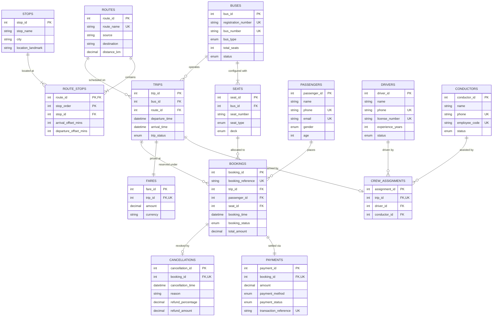

# BUS RESERVATION AND FLEET SCHEDULING SYSTEM
**A Complete Database Management Systems (DBMS) Academic Capstone Project**  
*Compliant with 3NF Relational Standards, ACID Transactions, and MySQL 8.0 Engine*

---

## 1. PROJECT TITLE
**BUS RESERVATION AND FLEET SCHEDULING SYSTEM (BRFSS)**

---

## 2. PROBLEM STATEMENT
Interstate and regional bus transportation services handle high volumes of concurrent seat bookings, variable tariffs, and fleet operations. Traditional manual or legacy software suffers from:
1. **Double Bookings**: Racing transactions attempting to reserve the same physical seat on the same trip schedule.
2. **Crew Scheduling Conflicts**: Accidental rostering of drivers and conductors across simultaneous or overlapping bus trips.
3. **Fleet Under-utilization**: Inability to correlate passenger load factors, bus capacity, and route revenue in real time.
4. **Data Redundancy & Anomalies**: Unnormalized tables causing insertion, deletion, and update anomalies across routes, stations, and passenger records.
5. **Lack of Transaction Isolation**: Partial booking failures leaving orphaned seat locks or mismatched payment records without automatic rollback.

This project delivers a relational database solution engineered on **MySQL 8.0** and **Flask**, enforcing declarative constraints, database-level triggers, ACID transactions, 3NF normalization, and analytical reporting views.

---

## 3. OBJECTIVES
- **Relational Integrity**: Design and normalize an enterprise schema up to Third Normal Form (3NF).
- **Concurrency & ACID Transactions**: Implement row-level locking (`FOR UPDATE`), atomic booking commits, and automatic rollbacks on constraint violation.
- **Declarative & Trigger Validation**: Enforce business rules at the database engine tier (prevent duplicate seat bookings, overlapping crew assignments, invalid scheduling, and double cancellations).
- **Comprehensive SQL Demonstrations**: Showcase complex SQL capabilities including 7-table JOINs, correlated subqueries, `HAVING`, `GROUP BY`, `EXISTS`, and categorical `CASE` expressions.
- **Executive Reporting Views**: Provide 7 specialized database views delivering real-time metrics on occupancy, route revenue yield, fleet utilization, and cancellation audits.

---

## 4. SCOPE
The application models:
- **Fleet Assets**: Buses, capacity classes, seat matrix (window, aisle, sleeper decks).
- **Transit Network**: Origin/destination routes, intermediate waypoints, arrival/departure offset timings.
- **Operations & Scheduling**: Trips, publishing workflows, fare specifications, crew assignments.
- **Customer Reservations**: Availability search, visual seat selection, transactional booking, digital payment settlement.
- **Audit & Cancellations**: Dynamic refund policy calculation, cancellation audit trails, and financial reconciliation.

---

## 5. SYSTEM USERS & ROLES
1. **System Administrator (ADMIN)**: Full CRUD permissions over fleet buses, network routes, stops, schedules, fares, and analytical reports.
2. **Fleet Dispatcher (DISPATCHER)**: Assigns certified drivers and conductors to trips; monitors fleet departure rosters and schedule conflicts.
3. **Counter Operator / Passenger (OPERATOR)**: Searches live trip availability, selects visual seats, executes ACID seat bookings, issues boarding vouchers, and processes cancellations.

---

## 6. FUNCTIONAL REQUIREMENTS
- **FR-1 Fleet Management**: Register buses with unique RTA registration, fleet unit number, bus type, and auto-instantiate seat layouts.
- **FR-2 Route & Waypoint Management**: Define origin and destination hubs, physical distance, and associate sequential stops with time offsets (M:N junction).
- **FR-3 Scheduling & Fares**: Schedule trips with strict departure < arrival validation, configure pricing, and publish services for public reservation.
- **FR-4 Crew Rostering**: Assign drivers and conductors to trips while validating absence of temporal schedule overlaps.
- **FR-5 Visual Seat Reservation**: Provide an interactive 2D seat map distinguishing available vs. booked seats; execute atomic reservation and payment insertion within a single ACID transaction.
- **FR-6 Cancellation & Dynamic Refunds**: Compute refund percentages based on lead time before departure (>24h: 100%, 12-24h: 75%, <12h: 50%); update booking and payment states atomically.
- **FR-7 Analytical Reports**: Present 10 distinct reports analyzing occupancy ratios, route revenue, bus yield, and payment method breakdowns.
- **FR-8 Live SQL Demonstration**: Provide an interactive faculty viva environment executing live queries against MySQL with explanations.

---

## 7. NON-FUNCTIONAL REQUIREMENTS
- **Data Consistency**: Strict enforcement of Foreign Keys with `ON DELETE RESTRICT` and `ON UPDATE CASCADE`.
- **Integrity Enforcement**: Database triggers ensure constraints cannot be bypassed even if backend code is circumvented.
- **Performance**: High-selectivity B-Tree indexing on passenger phone/email, trip schedules, and booking references.
- **ACID Compliance**: Strict transactional boundaries (`START TRANSACTION ... COMMIT / ROLLBACK`) on all seat reservation and cancellation flows.
- **Usability**: Responsive, intuitive dashboard styled with Bootstrap 5.

---

## 8. ENTITY-RELATIONSHIP (ER) MODEL



---

## 9. RELATIONAL SCHEMA

1. **`BUSES`** (`bus_id` [PK], `registration_number` [UQ], `bus_number` [UQ], `bus_type`, `total_seats`, `status`, `created_at`)
2. **`ROUTES`** (`route_id` [PK], `route_name` [UQ], `source`, `destination`, `distance_km`, `estimated_duration_hours`, `created_at`)
3. **`STOPS`** (`stop_id` [PK], `stop_name`, `city`, `location_landmark`, `created_at`, UQ(`stop_name`, `city`))
4. **`ROUTE_STOPS`** (`route_id` [PK, FK &rarr; ROUTES.route_id], `stop_order` [PK], `stop_id` [FK &rarr; STOPS.stop_id], `arrival_offset_mins`, `departure_offset_mins`, UQ(`route_id`, `stop_id`))
5. **`SEATS`** (`seat_id` [PK], `bus_id` [FK &rarr; BUSES.bus_id], `seat_number`, `seat_type`, `deck`, UQ(`bus_id`, `seat_number`))
6. **`DRIVERS`** (`driver_id` [PK], `name`, `phone` [UQ], `license_number` [UQ], `experience_years`, `status`, `created_at`)
7. **`CONDUCTORS`** (`conductor_id` [PK], `name`, `phone` [UQ], `employee_code` [UQ], `status`, `created_at`)
8. **`TRIPS`** (`trip_id` [PK], `bus_id` [FK &rarr; BUSES.bus_id], `route_id` [FK &rarr; ROUTES.route_id], `departure_time`, `arrival_time`, `trip_status`, `created_at`)
9. **`CREW_ASSIGNMENTS`** (`assignment_id` [PK], `trip_id` [FK &rarr; TRIPS.trip_id, UQ], `driver_id` [FK &rarr; DRIVERS.driver_id], `conductor_id` [FK &rarr; CONDUCTORS.conductor_id], `assigned_at`)
10. **`FARES`** (`fare_id` [PK], `trip_id` [FK &rarr; TRIPS.trip_id, UQ], `amount`, `currency`, `created_at`)
11. **`PASSENGERS`** (`passenger_id` [PK], `name`, `phone` [UQ], `email` [UQ], `gender`, `age`, `created_at`)
12. **`BOOKINGS`** (`booking_id` [PK], `booking_reference` [UQ], `trip_id` [FK &rarr; TRIPS.trip_id], `passenger_id` [FK &rarr; PASSENGERS.passenger_id], `seat_id` [FK &rarr; SEATS.seat_id], `booking_time`, `booking_status`, `total_amount`, `created_at`)
13. **`CANCELLATIONS`** (`cancellation_id` [PK], `booking_id` [FK &rarr; BOOKINGS.booking_id, UQ], `cancellation_time`, `reason`, `refund_percentage`, `refund_amount`, `created_at`)
14. **`PAYMENTS`** (`payment_id` [PK], `booking_id` [FK &rarr; BOOKINGS.booking_id, UQ], `amount`, `payment_method`, `payment_status`, `payment_time`, `transaction_reference` [UQ], `created_at`)
15. **`ADMIN_USERS`** (`user_id` [PK], `username` [UQ], `password_hash`, `full_name`, `role`, `created_at`)

---

## 10. NORMALIZATION UP TO 3NF

### First Normal Form (1NF)
- **Elimination of Repeating Groups**: Multi-valued attributes (such as passenger phone numbers or intermediate stop lists) are stored as distinct relational entities (`PASSENGERS`, `ROUTE_STOPS`).
- **Atomic Values**: Every table column contains only single, indivisible values (e.g., source and destination are separate columns, not combined strings).
- **Primary Keys**: Every relation has a defined primary key.

### Second Normal Form (2NF)
- A relation is in 2NF if it is in 1NF and every non-prime attribute is **fully functionally dependent** on the primary key (no partial dependencies).
- In composite key relations like `ROUTE_STOPS(route_id, stop_order)`:
  - `arrival_offset_mins` and `departure_offset_mins` depend on the composite pair `(route_id, stop_order)`, not on `route_id` alone.
  - Stop details (`stop_name`, `city`) were isolated into their own entity `STOPS(stop_id)` to avoid partial dependencies.

### Third Normal Form (3NF)
- A relation is in 3NF if it is in 2NF and **no non-prime attribute is transitively dependent** on the primary key ($X \to Y$ and $Y \to Z$ where $Z$ is non-prime is disallowed).
- In `BOOKINGS`: We store `passenger_id` as a foreign key rather than copying passenger details (`name`, `email`, `phone`). If passenger name were in `BOOKINGS`, `booking_id -> passenger_id -> passenger_name` would form a transitive dependency.
- In `TRIPS`: Fare information is normalized into `FARES(trip_id)`.
- In `PAYMENTS`: Payment attributes depend on `payment_id`, referencing `booking_id` 1:1, avoiding embedding transactional banking data in `BOOKINGS`.

---

## 11. FUNCTIONAL DEPENDENCIES

- **`BUSES`**:
  $$\text{bus\_id} \to \{\text{registration\_number}, \text{bus\_number}, \text{bus\_type}, \text{total\_seats}, \text{status}\}$$
  $$\text{registration\_number} \to \{\text{bus\_id}, \text{bus\_number}, \text{bus\_type}, \text{total\_seats}, \text{status}\}$$
- **`ROUTES`**:
  $$\text{route\_id} \to \{\text{route\_name}, \text{source}, \text{destination}, \text{distance\_km}, \text{estimated\_duration\_hours}\}$$
- **`STOPS`**:
  $$\text{stop\_id} \to \{\text{stop\_name}, \text{city}, \text{location\_landmark}\}$$
- **`ROUTE_STOPS`**:
  $$\{\text{route\_id}, \text{stop\_order}\} \to \{\text{stop\_id}, \text{arrival\_offset\_mins}, \text{departure\_offset\_mins}\}$$
- **`SEATS`**:
  $$\text{seat\_id} \to \{\text{bus\_id}, \text{seat\_number}, \text{seat\_type}, \text{deck}\}$$
  $$\{\text{bus\_id}, \text{seat\_number}\} \to \{\text{seat\_id}, \text{seat\_type}, \text{deck}\}$$
- **`TRIPS`**:
  $$\text{trip\_id} \to \{\text{bus\_id}, \text{route\_id}, \text{departure\_time}, \text{arrival\_time}, \text{trip\_status}\}$$
- **`BOOKINGS`**:
  $$\text{booking\_id} \to \{\text{booking\_reference}, \text{trip\_id}, \text{passenger\_id}, \text{seat\_id}, \text{booking\_time}, \text{booking\_status}, \text{total\_amount}\}$$
  $$\text{booking\_reference} \to \{\text{booking\_id}, \text{trip\_id}, \dots\}$$
- **`CANCELLATIONS`**:
  $$\text{cancellation\_id} \to \{\text{booking\_id}, \text{cancellation\_time}, \text{reason}, \text{refund\_percentage}, \text{refund\_amount}\}$$
  $$\text{booking\_id} \to \{\text{cancellation\_id}, \text{cancellation\_time}, \text{reason}, \dots\}$$
- **`PAYMENTS`**:
  $$\text{payment\_id} \to \{\text{booking\_id}, \text{amount}, \text{payment\_method}, \text{payment\_status}, \text{payment\_time}, \text{transaction\_reference}\}$$
  $$\text{transaction\_reference} \to \{\text{payment\_id}, \text{booking\_id}, \dots\}$$

---

## 12. DATA DICTIONARY

| Table Name | Attribute | Data Type | Constraint | Description |
|:---|:---|:---|:---|:---|
| **buses** | `bus_id` | INT AUTO_INCREMENT | PK | Unique identifier for bus asset |
| | `registration_number` | VARCHAR(20) | NOT NULL, UNIQUE | Official RTA vehicle registration number |
| | `bus_number` | VARCHAR(20) | NOT NULL, UNIQUE | Fleet unit identifier (e.g., BUS-101) |
| | `bus_type` | ENUM(...) | NOT NULL | Category (Volvo, Sleeper, Seater, Electric) |
| | `total_seats` | INT | NOT NULL, CHECK (>0 AND <=60) | Seating capacity of bus |
| | `status` | ENUM(...) | NOT NULL, DEFAULT 'ACTIVE' | Operational condition (ACTIVE, MAINTENANCE, INACTIVE) |
| **routes** | `route_id` | INT AUTO_INCREMENT | PK | Unique identifier for transit route |
| | `route_name` | VARCHAR(100) | NOT NULL, UNIQUE | Public name of arterial route |
| | `source` | VARCHAR(60) | NOT NULL | Origin city hub |
| | `destination` | VARCHAR(60) | NOT NULL, CHECK(!=source) | Destination city hub |
| | `distance_km` | DECIMAL(6,2) | NOT NULL, CHECK(>0) | Total route travel distance in kilometers |
| **stops** | `stop_id` | INT AUTO_INCREMENT | PK | Unique identifier for waypoint/station |
| | `stop_name` | VARCHAR(100) | NOT NULL | Designation of pickup/drop station |
| | `city` | VARCHAR(60) | NOT NULL | Metropolitan jurisdiction |
| **route_stops** | `route_id` | INT | PK, FK &rarr; routes | Associated route |
| | `stop_order` | INT | PK, CHECK(>=1) | Sequential waypoint order |
| | `stop_id` | INT | FK &rarr; stops, UNIQUE(`route_id`,`stop_id`) | Referenced stop |
| | `arrival_offset_mins`| INT | NOT NULL, DEFAULT 0 | Transit elapsed minutes to arrival |
| | `departure_offset_mins`| INT| NOT NULL, CHECK(>=arrival) | Transit elapsed minutes to departure |
| **seats** | `seat_id` | INT AUTO_INCREMENT | PK | Unique inventory identifier |
| | `bus_id` | INT | FK &rarr; buses(bus_id) | Bus unit vehicle containing the seat |
| | `seat_number` | VARCHAR(10) | NOT NULL, UNIQUE(`bus_id`,`seat_number`)| Seat label (e.g. S01, L01, U01) |
| | `seat_type` | ENUM(...) | NOT NULL | WINDOW, AISLE, SLEEPER_LOWER, SLEEPER_UPPER |
| | `deck` | ENUM(...) | NOT NULL | LOWER or UPPER deck |
| **trips** | `trip_id` | INT AUTO_INCREMENT | PK | Unique scheduled service instance |
| | `bus_id` | INT | FK &rarr; buses(bus_id) | Bus allocated to journey |
| | `route_id` | INT | FK &rarr; routes(route_id) | Traversed travel route |
| | `departure_time` | DATETIME | NOT NULL | Scheduled start timestamp |
| | `arrival_time` | DATETIME | NOT NULL, CHECK(>departure) | Scheduled termination timestamp |
| | `trip_status` | ENUM(...) | NOT NULL, DEFAULT 'SCHEDULED' | SCHEDULED, PUBLISHED, COMPLETED, CANCELLED |
| **passengers** | `passenger_id` | INT AUTO_INCREMENT | PK | Unique passenger identifier |
| | `name` | VARCHAR(100) | NOT NULL | Full passenger name |
| | `phone` | VARCHAR(15) | NOT NULL, UNIQUE | Contact mobile telephone number |
| | `email` | VARCHAR(100) | NOT NULL, UNIQUE | Contact email address |
| | `age` | INT | NOT NULL, CHECK(>=1 AND <=120)| Age in completed years |
| **bookings** | `booking_id` | INT AUTO_INCREMENT | PK | Unique ticket reservation record |
| | `booking_reference`| VARCHAR(25) | NOT NULL, UNIQUE | Public reservation PNR code (e.g., BKG-XXXX) |
| | `trip_id` | INT | FK &rarr; trips(trip_id) | Journey reserved |
| | `passenger_id` | INT | FK &rarr; passengers | Customer who purchased the ticket |
| | `seat_id` | INT | FK &rarr; seats(seat_id) | Physical seat allocated |
| | `booking_status` | ENUM(...) | NOT NULL, DEFAULT 'CONFIRMED'| CONFIRMED or CANCELLED |
| | `total_amount` | DECIMAL(8,2) | NOT NULL, CHECK(>=0) | Ticket fare collected |
| **cancellations**| `cancellation_id` | INT AUTO_INCREMENT | PK | Unique cancellation revocation audit record |
| | `booking_id` | INT | FK &rarr; bookings, UNIQUE | Associated booking |
| | `cancellation_time`| DATETIME | NOT NULL, DEFAULT CURRENT_TIMESTAMP | Cancellation timestamp |
| | `reason` | VARCHAR(255) | NOT NULL | Text explanation |
| | `refund_percentage`| DECIMAL(5,2)| CHECK(>=0 AND <=100) | Computed percentage refund |
| | `refund_amount` | DECIMAL(8,2) | CHECK(>=0) | Computed refund currency value |
| **payments** | `payment_id` | INT AUTO_INCREMENT | PK | Settlement ledger record |
| | `booking_id` | INT | FK &rarr; bookings, UNIQUE | 1:1 linked booking record |
| | `amount` | DECIMAL(8,2) | NOT NULL, CHECK(>0) | Monetary settlement amount |
| | `payment_method` | ENUM(...) | NOT NULL | UPI, CREDIT_CARD, DEBIT_CARD, NET_BANKING, CASH |
| | `payment_status` | ENUM(...) | NOT NULL, DEFAULT 'PAID' | PAID, PENDING, REFUNDED, FAILED |
| | `transaction_reference`| VARCHAR(60)| NOT NULL, UNIQUE | Financial transaction reference |

---

## 13. DATABASE CONSTRAINTS & BUSINESS RULES

1. **Rule 1 & Rule 3 (Seat Inventory Integrity)**:
   - Primary table constraint: `UNIQUE(bus_id, seat_number)` on `SEATS`.
   - Trigger `trg_prevent_duplicate_seat_booking`: Before insert on `BOOKINGS`, queries existing active reservations. If `(trip_id, seat_id, booking_status='CONFIRMED')` exists, raises SQLSTATE `45000` with message `'Seat is already booked for this trip.'`
2. **Rule 2 (Seat-Bus Allocation Matching)**:
   - Trigger `trg_validate_seat_belongs_to_bus`: Validates that `SEATS.bus_id == TRIPS.bus_id`. Prevents reserving seats allocated to a different bus asset.
3. **Rule 4 & Rule 5 (Temporal Validation)**:
   - `CHECK (departure_time < arrival_time)` on `TRIPS`.
   - `CHECK (source != destination)` on `ROUTES`.
4. **Rule 6 & Rule 7 (Crew & Bus Overlap Prevention)**:
   - Trigger `trg_prevent_bus_overlap`: Rejects trip insertion if the same `bus_id` is scheduled for another non-cancelled trip with overlapping time intervals:
     $$(D_{\text{new}} < A_{\text{existing}}) \land (A_{\text{new}} > D_{\text{existing}})$$
   - Trigger `trg_prevent_driver_overlap`: Rejects crew assignment if the driver is already rostered on an overlapping non-cancelled trip.
   - Trigger `trg_prevent_conductor_overlap`: Rejects crew assignment if the conductor is already rostered on an overlapping non-cancelled trip.
5. **Rule 8 & Rule 9 (Cancellation & Double Cancellation Prevention)**:
   - `cancellations.booking_id` is defined as `UNIQUE`.
   - Trigger `trg_validate_cancellation`: Rejects cancellation if booking status is already `'CANCELLED'`.
   - Trigger `trg_after_cancellation_sync`: Automatically updates `bookings.booking_status = 'CANCELLED'` and `payments.payment_status = 'REFUNDED'`.

---

## 14. SQL OPERATIONS DEMONSTRATION

All 25 core SQL concepts required by DBMS academic curricula are implemented and executed:

| Concept | SQL Statement / Pattern | File Reference |
|:---|:---|:---|
| **1. INSERT** | `INSERT INTO passengers (name, phone, email, gender, age) VALUES (...)` | `database/queries.sql` #1 |
| **2. UPDATE** | `UPDATE drivers SET status = 'ON_LEAVE' WHERE driver_id = 3` | `database/queries.sql` #2 |
| **3. DELETE** | `DELETE FROM passengers WHERE passenger_id NOT IN (SELECT passenger_id FROM bookings)` | `database/queries.sql` #3 |
| **4. SELECT** | `SELECT bus_id, registration_number, bus_type FROM buses WHERE status = 'ACTIVE'` | `database/queries.sql` #4 |
| **5. WHERE** | Predicate filtering on strings, dates, and enumerations | `database/queries.sql` #4, #13 |
| **6. ORDER BY** | Sorting by `total_seats DESC, bus_number ASC` | `database/queries.sql` #4 |
| **7. GROUP BY** | Categorical aggregation across `bus_type` and `route_id` | `database/queries.sql` #5, #6 |
| **8. HAVING** | `HAVING COUNT(DISTINCT t.trip_id) >= 2 AND COUNT(bk.booking_id) > 2` | `database/queries.sql` #6 |
| **9. INNER JOIN** | `trips t INNER JOIN routes r ON t.route_id = r.route_id` | `database/queries.sql` #7 |
| **10. LEFT JOIN** | Preserving idle drivers with zero active trip assignments | `database/queries.sql` #8 |
| **11. Multi-Table JOIN**| 7-table join: `bookings -> passengers -> trips -> routes -> buses -> seats -> payments` | `database/queries.sql` #9 |
| **12. Aggregations** | `COUNT(*)`, `SUM(total_seats)`, `AVG(total_seats)`, `MIN(seats)`, `MAX(seats)` | `database/queries.sql` #5 |
| **13. Subquery** | Scalar subquery: `WHERE distance_km > (SELECT AVG(distance_km) FROM routes)` | `database/queries.sql` #10 |
| **14. Correlated Subquery**| Selecting trips with higher bookings than the route average | `database/queries.sql` #11 |
| **15. EXISTS / NOT EXISTS**| `WHERE EXISTS (SELECT 1 FROM cancellations WHERE ...)` | `database/queries.sql` #12 |
| **16. BETWEEN** | `WHERE departure_time BETWEEN '2026-10-01' AND '2026-10-31'` | `database/queries.sql` #13 |
| **17. LIKE** | Wildcard matching: `WHERE email LIKE '%@gmail.com' AND phone LIKE '98%'` | `database/queries.sql` #14 |
| **18. CASE Expression** | Conditional load factor banding: `CASE WHEN pct >= 0.8 THEN 'High Demand' ... END` | `database/queries.sql` #15 |
| **19. Views** | Compiling analytics into virtual tables (`v_route_revenue`, `v_trip_occupancy`) | `database/views.sql` |
| **20. Transactions** | ACID seat booking with `START TRANSACTION`, `FOR UPDATE`, and `COMMIT` | `database/queries.sql` #17, `app.py` |

---

## 15. DATABASE VIEWS
The project includes 7 pre-compiled SQL views:
1. **`available_trip_view`**: Joins trips, routes, buses, fares, and active booking counts to calculate real-time available seats.
2. **`trip_occupancy_view`**: Computes booked seats, cancellations, and load factor percentage ($$ \text{Occupancy} = \frac{\text{Booked Seats}}{\text{Total Seats}} \times 100 $$).
3. **`passenger_booking_history`**: Traverses passenger tickets, seat numbers, journey dates, fare, and payment status.
4. **`route_revenue_view`**: Aggregates gross tariff collections, total refunds, and net profitability per route.
5. **`fleet_utilization_view`**: Evaluates individual bus asset deployment, completed journeys, and total revenue yield.
6. **`crew_schedule_view`**: Centralizes dispatch roster correlating drivers, conductors, bus units, and departure times.
7. **`cancellation_report_view`**: Audit report analyzing refund disbursements, lead times, and passenger cancellation reasons.

---

## 16. ACID TRANSACTIONS & CONCURRENCY CONTROL

### Seat Reservation Transaction Workflow
```text
BEGIN TRANSACTION
  │
  ├─► 1. Query trip details & fare (SELECT ... FOR UPDATE)
  │      └─ Verify trip exists & trip_status IN ('PUBLISHED', 'SCHEDULED')
  │
  ├─► 2. Query seat details
  │      └─ Verify seat.bus_id == trip.bus_id
  │
  ├─► 3. Check seat booking status (SELECT ... FOR UPDATE)
  │      └─ If confirmed booking exists: ROLLBACK with error "Seat is already booked"
  │
  ├─► 4. Resolve passenger entity (INSERT or SELECT passenger_id)
  │
  ├─► 5. INSERT into bookings (booking_reference, trip_id, passenger_id, seat_id, ...)
  │
  ├─► 6. INSERT into payments (booking_id, amount, payment_method, 'PAID', ...)
  │
  └─► 7. COMMIT TRANSACTION (Atomic write to persistent storage)
```
*If any step encounters an exception, an explicit `ROLLBACK` is issued, ensuring zero dirty writes or half-allocated seats.*

---

## 17. DATABASE INDEXING RATIONALE
Indexes were engineered on attributes based on selectivity and join cardinality:
- **`passengers(phone)` & `passengers(email)`**: Unique B-Tree indexes allowing $O(\log N)$ passenger lookup during ticket checkout.
- **`trips(departure_time)`**: High-selectivity range index optimizing temporal search (`WHERE departure_time BETWEEN ...`).
- **`trips(route_id)` & `trips(bus_id)`**: Foreign key join indexes accelerating multi-table relational equi-joins.
- **`bookings(trip_id)` & `bookings(seat_id)`**: Composite filtering indexes for fast seat collision detection.
- **`routes(source, destination)`**: Composite B-Tree index accelerating origin-destination query matching.

---

## 18. APPLICATION ARCHITECTURE
```text
┌────────────────────────────────────────────────────────┐
│                   BROWSER / CLIENT                     │
│  Bootstrap 5 Dashboard • Interactive SVG Seat Grid     │
└───────────────────────────┬────────────────────────────┘
                            │ HTTP GET / POST
┌───────────────────────────▼────────────────────────────┐
│                  FLASK APPLICATION (app.py)            │
│  Authentication • Parameter Validation • Route Engine  │
└───────────────────────────┬────────────────────────────┘
                            │ mysql-connector-python
┌───────────────────────────▼────────────────────────────┐
│                    MYSQL 8.0 DATABASE                  │
│  InnoDB Engine • 3NF Tables • Constraints • Triggers   │
│  Views • ACID Transactions • Row-Level Locks           │
└────────────────────────────────────────────────────────┘
```

---

## 19. TESTING & VERIFICATION SUMMARY

Automated test suite (`pytest`) executing across 17 test cases:

```text
============================= test session starts =============================
platform win32 -- Python 3.13.15, pytest-9.1.1
rootdir: C:\Users\pavan\Documents\DBMS_Project
collected 17 items

tests/test_app.py::test_login_page PASSED                                [  5%]
tests/test_app.py::test_login_and_dashboard_flow PASSED                  [ 11%]
tests/test_app.py::test_authenticated_pages PASSED                       [ 17%]
tests/test_app.py::test_seat_layout_page PASSED                          [ 23%]
tests/test_database.py::test_valid_bus_insertion PASSED                  [ 29%]
tests/test_database.py::test_duplicate_bus_insertion_rejected PASSED     [ 35%]
tests/test_database.py::test_valid_route_creation PASSED                 [ 41%]
tests/test_database.py::test_invalid_route_source_destination_same PASSED [ 47%]
tests/test_database.py::test_invalid_trip_departure_arrival_order PASSED [ 52%]
tests/test_database.py::test_overlapping_bus_trip_rejected PASSED        [ 58%]
tests/test_database.py::test_overlapping_driver_schedule_rejected PASSED [ 64%]
tests/test_database.py::test_duplicate_seat_booking_rejected_by_trigger PASSED [ 70%]
tests/test_database.py::test_seat_does_not_belong_to_bus_rejected PASSED [ 76%]
tests/test_database.py::test_atomic_booking_transaction_commit PASSED    [ 82%]
tests/test_database.py::test_atomic_booking_transaction_rollback_on_failure PASSED [ 88%]
tests/test_database.py::test_successful_cancellation_and_trigger_sync PASSED [ 94%]
tests/test_database.py::test_database_views_accessibility PASSED         [100%]

============================= 17 passed in 0.89s ==============================
```

---

## 20. SETUP & INSTALLATION INSTRUCTIONS

### Prerequisites
- Python 3.10+
- MySQL Server 8.0+ running on `localhost:3306`

### Installation Steps
1. **Clone / Navigate to Repository**:
   ```powershell
   cd c:\Users\pavan\Documents\DBMS_Project
   ```

2. **Install Python Dependencies**:
   ```powershell
   pip install -r requirements.txt
   ```

3. **Configure Database Connection**:
   Update `config.py` if your local MySQL root credentials differ:
   ```python
   MYSQL_HOST = 'localhost'
   MYSQL_PORT = 3306
   MYSQL_USER = 'root'
   MYSQL_PASSWORD = 'YourPassword'
   MYSQL_DB = 'bus_fleet_db'
   ```

4. **Initialize Database Schema, Triggers, Views & Seed Data**:
   ```powershell
   python setup_database.py
   ```
   *This automatically executes `schema.sql`, `constraints.sql`, `views.sql`, and `seed_data.sql` and prints verification counts.*

5. **Run Automated Test Suite**:
   ```powershell
   pytest -v
   ```

6. **Start Flask Server**:
   ```powershell
   python app.py
   ```
   Open your browser and visit: `http://127.0.0.1:5000`

### Default Login Credentials
- **Administrator**: `admin` / `admin123`
- **Fleet Dispatcher**: `dispatcher1` / `dispatcher123` (or `dispatcher` / `dispatcher123`)
- **Counter Operator**: `operator1` / `operator123` (or `operator` / `operator123`)

---

## 21. FACULTY VIVA GUIDE & DEMO WALKTHROUGH

| Step | Action in Application | Relational DBMS Concept to Explain |
|:---|:---|:---|
| **1. Login** | Enter `admin` / `admin123` | Password hashing using Werkzeug scrypt; session role authorization. |
| **2. Dashboard** | Observe KPI cards | Computed via real SQL: `COUNT(*)`, `SUM()`, and view queries (no hardcoded numbers). |
| **3. Buses & Seats** | Click "Add New Bus" | Demonstrates PK, UNIQUE registration constraint, and auto-instantiation of 40 seat tuples. |
| **4. Routes & Stops** | View Waypoints on Route 1 | Resolves M:N relationship between Routes and Stops using `route_stops` junction table with sequence order. |
| **5. Schedule Trip** | Try scheduling arrival < departure | MySQL `CHECK (departure_time < arrival_time)` constraint rejects the tuple. |
| **6. Crew Conflicts** | Assign busy driver to overlapping trip | Trigger `trg_prevent_driver_overlap` executes and raises error message. |
| **7. Reserve Seat** | Go to Search &rarr; Select Trip 11 | Multi-table join filters active trips; opens visual seat layout grid. |
| **8. Seat Map** | Click free seat & book | Demonstrates ACID transaction: row-level lock (`FOR UPDATE`), atomic booking insert, and payment insert. |
| **9. Double Booking** | Try booking same seat in another tab | Database trigger `trg_prevent_duplicate_seat_booking` fires and prevents race conditions. |
| **10. Cancellation**| Click Cancel on booking | Dynamic refund formula calculates refund percentage; triggers update booking to `CANCELLED` and payment to `REFUNDED`. |
| **11. Reports** | Open "DBMS Reports" | Explains `route_revenue_view`, `trip_occupancy_view`, and `fleet_utilization_view`. |
| **12. SQL Demo** | Open "SQL Viva Demo" | Demonstrates live executed queries and uses the interactive SQL console for faculty queries. |

---

## 22. CONCLUSION & FUTURE ENHANCEMENTS

### Conclusion
The **Bus Reservation and Fleet Scheduling System** proves that critical business invariants (seat collisions, overlapping crew schedules, cancellation state consistency) are best enforced natively at the relational database engine level through normalization, constraints, transactions, and triggers, rather than solely relying on application code.

### Future Enhancements
- Integration of spatial GIS data types (`ST_Point`, `ST_Distance_Sphere`) for real-time bus GPS tracking.
- Dynamic pricing algorithms based on occupancy load factors using stored procedures.
- SMS and email notification triggers via external message queue integration.
